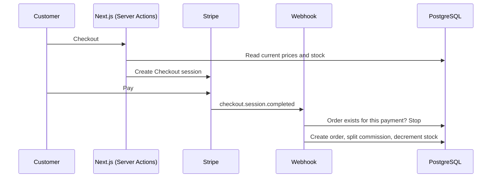

# STP Market


**A multi-vendor marketplace for products from São Tomé and Príncipe, sold to customers in Portugal.** Producers apply to sell, the admin approves them, customers pay with Stripe, and each sale is split between the vendor and the platform's commission.

**Live demo:** [stp-dusky.vercel.app](https://stp-dusky.vercel.app)


## Features

**Customers**
- Catalogue with search, category filter and sorting
- Cart, Stripe Checkout and order confirmation by email
- Account with order history and order status
- FAQ assistant for shipping, orders and selling questions

**Vendors**
- Application form with supporting documents, reviewed by the admin
- Own product management with Cloudinary images
- Balance from sales (after commission) and withdrawal requests
- Password recovery

**Admin**
- Dashboard, products, categories and stock
- Orders with status updates
- Vendor applications, vendor accounts and withdrawals

## How it works



- **Prices come from the database**, never from the browser: the checkout recalculates every line on the server.
- **Idempotent webhook:** the Stripe signature is verified, and an order is created only once per payment intent, so a retried webhook cannot duplicate an order.
- **Stock changes only after payment**, never when an item is added to the cart.
- **Commission per sale:** each order item records the vendor amount and the platform commission (`COMMISSION_RATE`).
- **Two authentication systems in one middleware:** customers sign in with Clerk; admin and vendor accounts use Auth.js (credentials, bcrypt, JWT sessions) on separate routes.

## Tech stack

| Area | Technologies |
|---|---|
| Front-end | Next.js 15 (App Router), React 19, TypeScript, Tailwind CSS, shadcn/ui, React Hook Form |
| Back-end | Server Actions, Route Handlers, Prisma, PostgreSQL (Neon), Zod |
| Auth | Clerk (customers), Auth.js v5 (admin and vendors) |
| Payments | Stripe Checkout and webhooks |
| Media and email | Cloudinary, Brevo |
| Deploy | Vercel |

## Getting started

Requirements: Node.js 20+ and a PostgreSQL database.

```bash
npm install                 # also generates the Prisma client
cp .env.example .env        # database, Clerk, Auth.js, Stripe, Cloudinary, Brevo
npx prisma migrate deploy
npx prisma db seed          # creates the first admin from ADMIN_EMAIL / ADMIN_PASSWORD
npm run dev                 # http://localhost:3000
```

To test payments locally, forward Stripe events with `stripe listen --forward-to localhost:3000/api/stripe/webhook`.

## Project structure

```text
app/
  (loja)/       public store: catalogue, product, cart, checkout, customer account
  admin/        admin panel
  fornecedor/   vendor panel
  api/          Stripe webhook and other route handlers
components/     UI components (shadcn/ui) and store components
lib/            Prisma client, Stripe, Cloudinary, email, shipping rules
prisma/         schema, migrations and seed
```

## Author

**Anderson Neto**, Full-Stack Developer in Lisbon. [Portfolio](https://andersonneto.gt.tc) · [LinkedIn](https://linkedin.com/in/anderson-fullstack-developer)

## License

[MIT](LICENSE)
